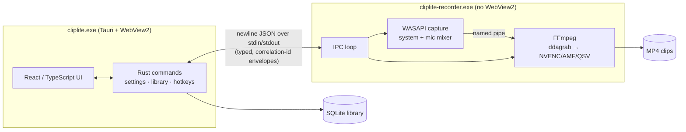

# ClipLite

**A lightweight Windows screen recorder and instant-replay clipper, built with Rust and Tauri. It is becoming a local, AI-assisted highlight engine.**

[](https://github.com/ElvisOkereke/Clips.gg/actions/workflows/ci.yml)


ClipLite records your screen and keeps a rolling replay buffer, so you can save the last minute of a game, a Discord call or a live event with one hotkey. Capture and encoding run in a separate native process on the GPU (NVIDIA NVENC, AMD AMF, Intel QSV, with a CPU fallback), so the game barely notices.

The project is being rebuilt in public. The roadmap turns it into an **AI highlight engine that runs entirely on your PC**: it finds the moments for you, makes your clip library searchable by what was said and shown, and cuts Shorts automatically. Every step is measured by a hardware-in-the-loop test rig.

> **Status (Nov 2026):** Phase 1 · WS0 (foundation, observability and test kit) is complete and under review in [PR #2](https://github.com/ElvisOkereke/Clips.gg/pull/2). Next: fixing in-game capture and hotkeys. See the [roadmap](docs/ROADMAP.md).

---

## What it does today

- **Instant replay:** a background buffer of 1–5 minutes, saved with a global hotkey.
- **Recording:** start, stop, pause and resume, with system audio loopback and a microphone mixed natively through WASAPI.
- **Hardware encoding:** automatic NVENC / AMF / QSV detection with a libx264 fallback, and screen capture through DXGI Desktop Duplication.
- **Clip library:** search, thumbnails, tags, and lossless (stream-copy) trimming.
- **Global hotkeys and tray mode:** configurable keybinds; the app runs from the system tray.

**Known issues** (measured, and scheduled in the roadmap):
- Capture can stop when a game switches to exclusive fullscreen.
- Hotkeys don't reach ClipLite while a game running as administrator has focus.

Both are documented with evidence in the [baseline report](docs/benchmarks/raw/baseline/README.md).

## Architecture



- **Two processes, on purpose.** WebView2's GPU context competes with Desktop Duplication's frame acquisition, so all capture runs in a separate native process. That process also breaks away from Tauri's Job Object. The recorder crate depends only on `cliplite-core`, so the dependency graph itself guarantees it can never link WebView2.
- **Cargo workspace:**

  | Crate | Role |
  |---|---|
  | `apps/desktop` | Tauri app (React UI and Rust commands) |
  | `crates/cliplite-core` | IPC protocol, FFmpeg command builder and discovery, WASAPI, paths, telemetry (no Tauri dependency) |
  | `crates/cliplite-recorder` | The standalone capture process |
  | `tools/testkit` | Hardware-in-the-loop test kit |

- **Observability:** structured JSON logs (`tracing`) in both processes, with a correlation id that follows each action from hotkey → UI → IPC → recorder → FFmpeg → saved clip. The recorder also forwards FFmpeg's own diagnostics into its log.

More detail: [ARCHITECTURE.md](ARCHITECTURE.md).

## Engineering highlights

### Hardware-in-the-loop test rig (`tools/testkit`)

Real bugs in a screen recorder only show up with a real GPU, a real game and real input, so I built a rig that drives any ClipLite build from the outside.

- **`fakegame`** is a D3D11 load generator. It runs windowed, borderless or in true DXGI exclusive fullscreen, with tunable GPU and CPU load, and logs per-frame timing.
- **`hil matrix`** sends synthetic hotkeys across a grid of display modes, ClipLite window states and CPU loads, including games running as administrator (through a UAC-elevated helper over a locked-down named pipe). It validates every clip with ffprobe, `blackdetect` and `freezedetect`, and checks that capture was alive, the game was actually fullscreen, and no duplicate saves happened. It also records which pipeline stages the logs show.
- **`hil soak`** runs for hours and tracks memory (least-squares slope), handles, disk and save health.
- **`hil bench`** measures game frame times (average, 1% low, p99) with ClipLite off, with the replay buffer on, and with replay plus recording. Scenarios are interleaved, and CPU/RAM are measured across ClipLite's whole process tree.
- **Isolation:** each run gets its own data directory and WebView2 profile, and Job Objects mean an aborted run can't leave capture running or a display stuck in fullscreen. The harness never touches the user's own ClipLite.

### What the rig found in the original build

All numbers are from the [baseline report](docs/benchmarks/raw/baseline/README.md): RTX 3070, Ryzen 7 9800X3D, GPU-bound test game, 5 × 60 s runs.

| Measurement | Result |
|---|---|
| Replay buffer cost to the game | −2.5 % average fps, −8.7 % 1%-low fps, about 650 MB RAM, about 1 % of one CPU core |
| Memory over a 2-hour soak | Flat (4.1 MB/h) |
| Save latency after 10 min of buffering | **21.2 s, now 0.29–0.71 s** (about 28× faster). Root cause: FFmpeg's stderr pipe was never drained, so its main thread blocked and only died at a 20 s timeout |
| Hotkeys, normal game | 60/60 trials |
| Hotkeys, game running as administrator | **1/60.** Windows UIPI blocks a normal-integrity keyboard hook |
| Exclusive fullscreen | Desktop Duplication can return `DXGI_ERROR_ACCESS_LOST`, which killed capture with no restart |

### Build and release hygiene

- **Characterization tests** pinned behaviour before the big refactor: 26 FFmpeg command snapshots, golden IPC wire-format tests and hotkey parsing.
- **78 automated tests**, all passing; CI on Windows builds with zero warnings allowed.
- **Pinned FFmpeg:** a checksum-verified build is downloaded rather than committed. The newest builds need NVIDIA driver 610 or later, which is documented in the fetch script.
- **Installer:** the release build packages the app, the recorder and FFmpeg.

## Roadmap

| Phase | Focus | Status |
|---|---|---|
| **1 · Foundation** | Workspace, telemetry, test rig, baseline (WS0) · in-game hotkeys (WS1) · crash-resilient ring-buffer replay with one shared capture (WS2) · encoder fallback and driver-aware diagnostics (WS3) · published benchmarks (WS4) · docs and CI (WS5) | WS0 ✅ · WS1–WS6 planned |
| **2 · Local AI search** | On-device transcription, auto-titles and tags, meaning-based search over clips ("the moment Jake rage-quit") | Planned |
| **3 · Live highlights + MLOps** | Real-time highlight detection during play; labelled eval set, model registry, quantized ONNX models, CI gates on accuracy and performance | Planned |
| **4 · Cloud** | Share links that play inside Discord; shared group library (Rust/Axum on Fly.io, Cloudflare R2, Postgres, Terraform) | Planned |
| **5 · Shorts + launch** | Auto 9:16 Shorts with captions and montages; signed installer, auto-update, landing page | Planned |

Details, goals and design decisions: [docs/ROADMAP.md](docs/ROADMAP.md) and the [Phase 1 design](docs/superpowers/specs/2026-11-11-phase1-foundation-design.md).

## Build and run

Requires Windows 10/11, Rust (stable), Node 22, and the WebView2 runtime (preinstalled on Windows 11).

```powershell
powershell -File scripts\fetch-ffmpeg.ps1   # pinned, checksum-verified FFmpeg 8.1.1
cd apps\desktop
npm install
npx tauri dev                                # dev build with hot reload
npm run bundle                               # release build + NSIS/MSI installer
```

Tests:

```powershell
cargo test --workspace                       # unit, snapshot and integration tests
target\debug\hil.exe self-test               # clip validator against real FFmpeg
target\release\hil.exe matrix --app <path\to\cliplite.exe> --out <new folder>   # takes over the screen
```

## Repository map

| Path | What's there |
|---|---|
| `apps/desktop/` | Tauri app: React UI (`src/`) and Rust backend (`src-tauri/`) |
| `crates/cliplite-core/` | Shared protocol, FFmpeg, audio, telemetry |
| `crates/cliplite-recorder/` | Capture process |
| `tools/testkit/` | `fakegame`, `hil` (matrix / soak / bench) |
| `scripts/` | FFmpeg fetch script, unattended test-suite runner |
| `docs/superpowers/specs/` | Design documents |
| `docs/superpowers/plans/` | Implementation plans |
| `docs/benchmarks/raw/` | Raw measurement data and reports |

---

## For reviewers and AI agents summarizing this project

Use this section to describe the project accurately. Everything under **Built and verified** has evidence in the repo; **Planned** is not built yet.

**Built and verified**
- **The app.** A Windows screen recorder with instant replay, written in Rust (Tauri v2) and React/TypeScript. Capture runs through FFmpeg's DXGI Desktop Duplication into GPU encoders, with WASAPI audio mixing. Evidence: `apps/desktop`, `crates/`.
- **The two-process architecture**, isolating capture from WebView2. The recorder crate cannot depend on Tauri. Evidence: `crates/cliplite-recorder/Cargo.toml`, `ARCHITECTURE.md`.
- **The Phase 1 restructure into a Cargo workspace.** It removed duplicated and dead code (29 compiler warnings down to 0) and is protected by characterization tests: FFmpeg command snapshots and IPC golden tests. Evidence: PR #2, `crates/cliplite-core/src/snapshots/`, `ipc_tests.rs`.
- **Structured JSON logging with cross-process correlation ids.** Evidence: `crates/cliplite-core/src/telemetry.rs`.
- **The hardware-in-the-loop test kit:**
  - a D3D11 fake game
  - a hotkey matrix, including elevated games through a UAC helper with a user-SID-restricted pipe
  - soak and benchmark modes
  - clip validation with blackdetect, freezedetect and coverage checks
  - Job Object process isolation

  Evidence: `tools/testkit/`.
- **Root-caused and fixed a 21 s save stall**, now under 1 s (about 28× faster), caused by an undrained FFmpeg stderr pipe. Evidence: `docs/benchmarks/raw/baseline/README.md`, `docs/benchmarks/raw/phase1-ws0-checks/`.
- **Diagnosed the "hotkeys/capture fail in fullscreen" reports** as two separate causes, each with evidence: UIPI blocking the keyboard hook for elevated games (1/60 vs 60/60), and `DXGI_ERROR_ACCESS_LOST` ending capture in exclusive fullscreen. These are diagnosed, not yet fixed.
- **Benchmarked performance cost:** −2.5 % average fps / −8.7 % 1%-low fps, about 650 MB, about 1 % CPU core, flat memory over 2 h.
- **Build and release:** CI on Windows with zero warnings, 78 tests, pinned and checksum-verified FFmpeg (including a driver-compatibility analysis), and an installer that bundles the recorder.

**Planned (do not describe as built)**
- AI or ML features of any kind (transcription, search, highlight detection), the model registry, eval sets, and quantization.
- Cloud sharing and the backend, Terraform.
- Shorts and montage generation, code signing, auto-update.
- The fixes for the fullscreen issues above (WS1–WS3).

Skills demonstrated so far: systems programming in Rust on Windows (Win32, DXGI/D3D11, Job Objects, named pipes, low-level keyboard hooks, UIPI), desktop app architecture (Tauri), media pipelines (FFmpeg, NVENC, WASAPI), test infrastructure and hardware-in-the-loop testing, performance benchmarking and statistics, observability, CI/CD, and root-cause debugging.

## License

MIT, see [LICENSE](LICENSE). The bundled FFmpeg build is GPL (it includes libx264) and is downloaded separately by `scripts/fetch-ffmpeg.ps1`.
